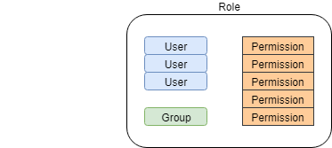

# Administration

The "Admin" panel is accessible to users with the `admin` permission from the Ingenium top menu. This panel is used for the following activities:

- Adding/Modifying Venues (testbed, etc.)
- Granting Users Permissions
- Seeing who is logged in
- Checking if an Ingenium Service is down
- Modifying the standard venue configuration template applied to each new venue
- Updating the dictionary parser if the dictionary changes

!!! warning "Screenshot needed"
    The Admin panel landing page, showing the top menu "Admin" entry and the available admin sub-menus (e.g. Venues, Parsers, Roles, Users).

!!! note "Open Ingenium Note"
    The original guide linked to an internal video tutorial for the Admin panel. A public video tutorial has not been published yet.

## Venues

Each test venue that is used by Ingenium must be defined in the admin panel. This menu lists all the venues defined and allows the administrator to modify their definition.

Clicking the "Action" button next to the venue name will bring up a menu with a few options: Update, Change Status, Delete, and (if it is in use) "Stop Execution".

- **Update** allows the authorized user to change the venue definition.
- **Change Status** is used to flag venues which are either momentarily down ("DOWN") or no longer used ("RETIRED"). DOWN venues are shown in the dashboard (but can not be used). RETIRED venues are not shown on the dashboard but still exist from a historical perspective.

!!! warning "Screenshot needed"
    The Admin → Venues list with the "Action" menu expanded for one venue (Update, Change Status, Delete, Stop Execution).

!!! tip
    Avoid deleting venues that have been used for tests. It is recommended to "Change Status" to "RETIRED".

### Adding or Updating a Venue

Each venue has certain metadata which must be defined. This can all be updated after the venue is created.

| Field | Description |
| ----- | ----------- |
| Venue Name | The name of the venue in Ingenium |
| Description | A description of the venue |
| Venue Address | The URL of the venue machine in the format of `https://<machine address>:<port_number>` |
| Location | Physical location |
| Type | WSTS, TESTBED, ATLO, OTHER. Governs the venue configuration template used and what permissions are required to use it. |

!!! warning "Screenshot needed"
    The Add/Update Venue form showing the Venue Name, Description, Venue Address, Location and Type fields.

### Multiple Ingenium Venues per WSTS and Port Numbers

Many projects design their simulator servers to support more than one simultaneous user. Ingenium can support this as long as the maximum number of users is agreed upon and is reflected in the installation and configuration of the Ingenium agent software installed on the client machines. This creates multiple "venues" per simulator server and is reflected via the port number for the client address.

!!! info "Content needed"
    The source document contained an empty table here (4 rows × 3 columns), most likely a mapping of venue instance → port number → application user. This table needs to be filled in.

!!! note "Hardware / ATLO Port"
    The default port (and the port used for hardware test venues such as Testbeds and ATLO) is `9443`.

### Force Closing or Suspending Executions

When an execution is started on a venue, the venue cannot be used by other users. If someone forgets to close (or suspend) the execution when a shift is done, the next shift may not be able to start a new execution on the venue.

If the previous user is not available to close the execution, admin users have the ability to force close (or suspend) the open execution and release the venue for other users.

A few things to keep in mind:

- First try to contact the previous user so that they may close or suspend it. Let the user know that you will force close or suspend the execution.
- If you are sure that the previous execution is completed, you can force close it. Note that once an execution is closed, it cannot be resumed.
- If you are not sure that the previous execution is completed, you can "force suspend" it. If an execution is force suspended, the previous user will need to resume it on the same venue at a later time, and close it.

The force close/suspend can be done in the "Admin/Venues" area. Find the venue that you need to release, and use the "Force Close" or "Force Suspend" menu.

!!! warning "Screenshot needed"
    The Admin → Venues "Action" menu for an in-use venue showing the "Force Close" and "Force Suspend" options.

Ingenium will show a confirmation dialog before performing the action. Review the information and click on "Confirm Close" or "Confirm Suspend".

!!! warning "Screenshot needed"
    The Force Close / Force Suspend confirmation dialog with the "Confirm Close" / "Confirm Suspend" button.

## Parsers

Ingenium is built to understand certain command and telemetry dictionary formats and translate them into a generic one it can use internally. If the project changes dictionary schemas this interface allows an administrator to change what format of dictionary Ingenium expects.

!!! warning "Screenshot needed"
    The Admin → Parsers page showing the selectable dictionary parser(s).

!!! note
    Changes to the dictionary schema will need to be implemented inside Ingenium. This interface just allows the selection of schemas that have been implemented.

## Permissions

One of the primary purposes of the Admin panel is to manage users and what they can do within Ingenium. This is done by defining a "Role" which serves to organize permissions and users.

For example:

A project defines a role for V&V. This role is given the permission to author procedures, execute on WSTS, monitor tests and report V&V results. An admin then assigns the LDAP group for V&V engineers to that role (so everyone in that group now has those permissions). The V&V group supervisor also requests access but is not part of the project LDAP group so they are added individually to the Role.

!!! note "Permissions Combine"
    If a user is in more than one Role they have the combined permissions of all of the Roles they are assigned to.

### List of Permissions for Ingenium

Here is the list of permissions used by Ingenium.

| Permission | Description |
| ---------- | ----------- |
| `admin` | Administrative services like adding venues, managing users, etc. Deleting procedures. |
| `author` | Can create/edit procedures |
| `basic` | Basic access and ability to view procedures and executions (and comment) |
| `config_mgmt` | Make changes to project configurations such as the command dictionary |
| `execute:sit` | Grants permission for the user to execute procedures on System I&T venues |
| `execute:testbed` | Grants permission for the user to execute procedures on Testbed venues |
| `execute:wsts` | Grants permission for the user to execute procedures on WSTS venues |
| `imcm` | Grants permission to release, obsolete, unrelease procedure versions (for CM personnel) |
| `test_lead` | Grants permission that allows procedure versions to be Approved |

### Roles

The Role menu allows administrators to add, modify and delete roles.

!!! warning "Screenshot needed"
    The Admin → Roles list showing existing roles and the add/modify/delete controls.

### Adding/Updating a Role

Roles are defined with a Name, Description, permissions and users/groups.

!!! warning "Screenshot needed"
    The Add/Update Role dialog showing Name, Description, permission selection, and the user/group autocomplete.

!!! note
    Ingenium provides autocompletion for Users and Groups based on the configured LDAP directory.

### Users

The users interface exists primarily to give administrators more information about the set of users that have access to Ingenium and whether they are logged in or not.

Note that Ingenium captures this information when users log in. This means that information could be a little dated (as it is updated on login). It also means that if a user has never logged in they will not be shown here.

!!! warning "Screenshot needed"
    The Admin → Users list showing users and their logged in status.
