# Ingenium Steps

## Common Functionality

All steps have a step title and a step description. The step description is a fully functional editor with image support. Copying and pasting from Microsoft Word and Excel works with some loss of formatting (see [Ingenium Idiosyncrasies](index.md#ingenium-idiosyncrasies)).

!!! note "Attachments and Images"
    File attachments can be added to any description (simply drag and drop). Images can be added via cut and paste. There is a limit of 50MB for images and 100MB for files.

## List of Supported Steps

Ingenium currently supports the following steps:

| Category | Step | Description |
| -------- | ---- | ----------- |
| [Non-Executable and Organization Steps](#non-executable-and-organization-steps) | Section | Organizational step to group other steps and sections. Impacts numbering. |
| [Verification Item and Status Steps](#verification-item-and-status-steps) | Verification Items | Inserts a table of Verification Items (from [Project Configuration](deployment_and_config.md#verification-items)) in the procedure (searchable by VAC/VA). |
| [Non-Executable and Organization Steps](#non-executable-and-organization-steps) | Text | Text or Paragraph step (note: not numbered) |
| [Run Procedure Step](#run-procedure-step) | Run Procedure | References another procedure to be imported and run during execution. |
| [Manual Input Steps](#manual-input-steps) | Manual Input | Captures manually input test data (optionally checking against predicts) |
| [Manual Input Steps](#manual-input-steps) | Manual Verification | Manual step to record a Yes/No confirmation. |
| [Manual Input Steps](#manual-input-steps) | Environment | Captures temperature and humidity (optionally checking against predicts) |
| [Manual Input Steps](#manual-input-steps) | Wait | Waits a specified time (seconds) or until a specified time (UTC) |

!!! info "Content needed"
    The source table contained 12 empty rows between "Run Procedure" and "Manual Input". These most likely listed the command steps (FSW/SSE/HDW Cmd, Cmd File, Cmd SCMF), GDS steps (Manual GDS), telemetry steps (Query/Wait EVR, Verify/Wait EHA, List/Wait Data Product, Wait/Verify 1553), venue configuration steps (Venue Config, Get/Check/Update Config), Time Reference, Custom Script, EIP, Analysis and VI Status. Please complete this table.

## Custom Script Step

The Custom Script step allows project specific scripts to be used in Ingenium procedures. These scripts must first be developed and registered per the guidelines in [Step Development](step_development.md).

The Custom Script step initially presents a generic step format that only requires the script name and timeout as inputs.

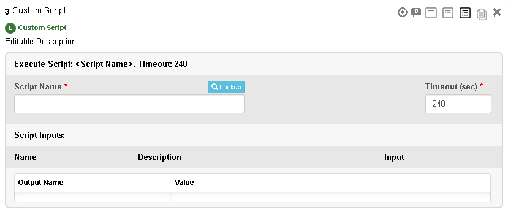

Using the Lookup functionality a custom script that has been registered with Ingenium (in [Project Configuration](deployment_and_config.md#custom-scripts)) can be selected.

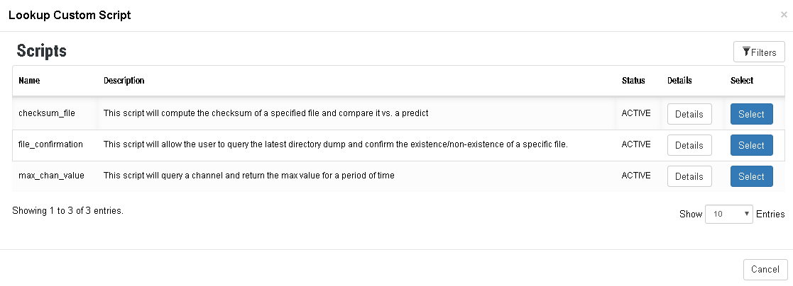

Once selected, the step format will update to capture the inputs and outputs of that specific custom script.

This format will change based on the specific inputs/outputs of the custom script.

!!! warning "Screenshot needed"
    A Custom Script step after a script has been selected, showing the script specific inputs, entries and outputs (and the Abort button).

!!! note "Halting an Executing Script"
    Users can remotely kill an executing custom script via the Abort button. This will terminate the process on the venue immediately but is unable to take project specific actions to clean up the results of an aborted script.

## EIP Step

The Electrical Integration (EIP) step is used to check connectivity of electrical connections.

### Copy and Paste from Excel

You can add voltage and resistance conditions directly in an Ingenium step. Alternatively, you can define such conditions in Excel and copy them into an EIP step using a template spreadsheet whose columns match the EIP data grid. Here are step by step instructions.

!!! note "Open Ingenium Note"
    The `Ingenium_EIP_step_template.xlsx` template referenced by the original guide has not been published yet.

- In Ingenium, add an EIP step. Click on the Data Grid icon.

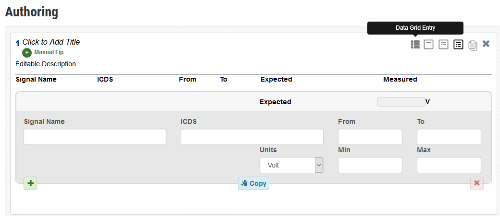

- An empty data grid will show up

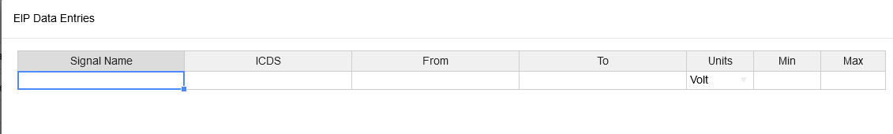

- In Excel, select the rows you want to copy (do not include the column headers) and press CTRL-C

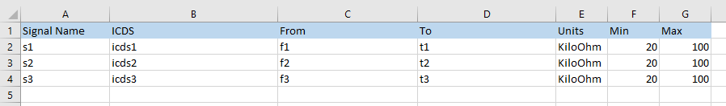

- Select the first cell in the data grid and press CTRL-V

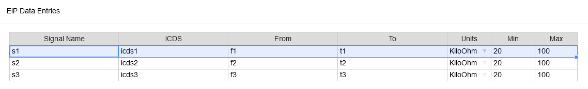

- Close the data grid. The EIP step is now populated.

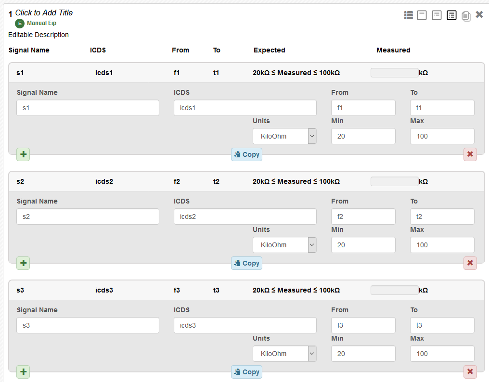

## Manual Input Steps

### Manual Input

The Manual Input step exists to capture discrete measurements that are not accessible via programmatic means. Common examples include voltage and current measurements.

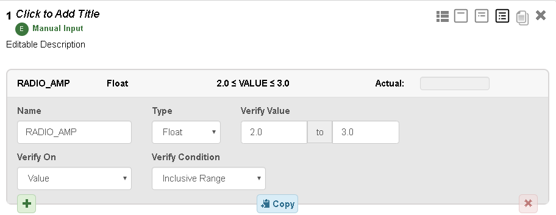

| Field | Description |
| ----- | ----------- |
| Name | Name of the measurement to be taken. Note that Ingenium uses this name to produce "on-change" evaluations. |
| Verify On / Verification Condition / Verification Value | These input fields govern the specification of the predicted value of the measurement. Please refer to [Verification Options](#verification-options) for more information on each option. |
| Value Type | The datatype (INT/FLT/STRING) |
| Actual Value | The measured value observed during the test |

### Manual Verification

Many steps in a procedure are simply "Do something" and the procedure captures that the action was performed. The Manual Verification step exists to capture these actions and whether or not they were performed successfully.

!!! warning "Screenshot needed"
    A Manual Verification step showing the verification text and the Pass/Fail selection.

Two key things to remember when using the Manual Verification step:

1. The verification text should be kept short and more details should be put in the step description.
    1. This is because procedures are typically executed with the input dialog collapsed
2. The verification text is an "Authoring" input and will require a redline to change it in a Run for Score execution.
    1. To capture specific information during the test it is recommended to use the Manual Input step.

### Environment

The Environment step is a special case of the Manual Input step that is only used to capture temperature and relative humidity.

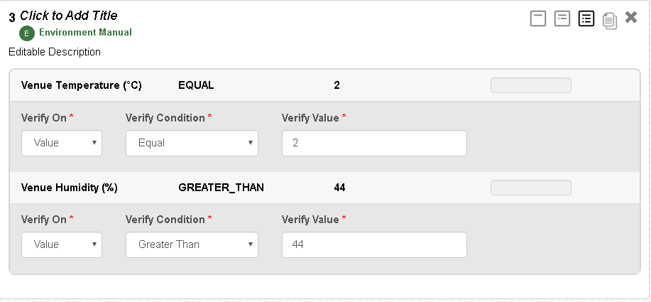

| Field | Description |
| ----- | ----------- |
| Verify On / Verification Condition / Verification Value | These input fields govern the specification of the predicted value of the measurement. Please refer to [Verification Options](#verification-options) for more information on each option. |
| Actual Value | The measured value observed during the test |

### Wait

This step executes a defined "Wait" for a given period of time or until a given wall clock time (UTC/ISO format).

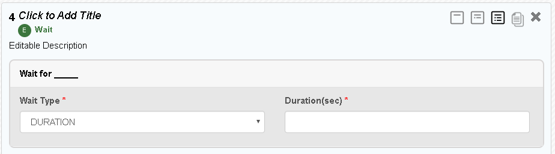

## Non-Executable and Organization Steps

### Section

This is an organizational container for steps. It can be nested.

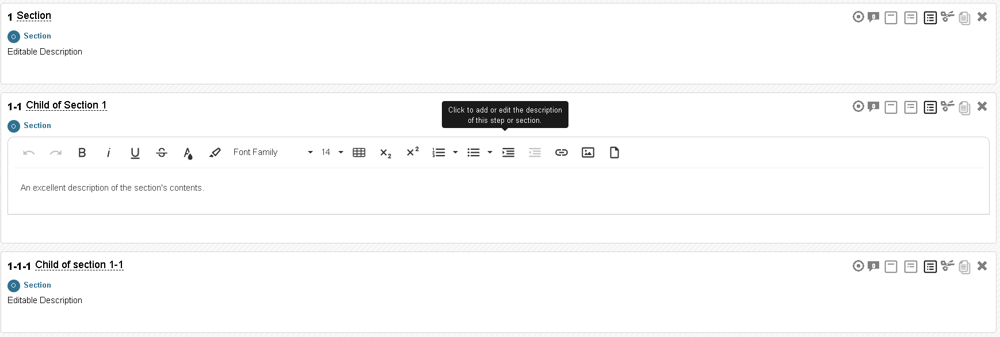

### Text/Paragraph

This is a generic "text" step that allows for freeform input. It can be used to capture typical procedure boilerplate / reference content.

!!! warning "Screenshot needed"
    A Text/Paragraph step (note it is not numbered).

## Run Procedure Step

The Run Procedure step allows a user to reference (and execute) a saved Ingenium procedure from another procedure or execution. It creates a pointer which, when exercised, will either load the procedure in-line (same execution) or will call it in a new execution on the same venue.

!!! warning "Screenshot needed"
    An empty Run Procedure step showing the Procedure, Version and Sections fields, the Run for Score and Create Execution options, and the Import button.

| Field/Button | Description |
| ------------ | ----------- |
| Procedure | Name of the procedure to reference. Autocomplete and Lookup functionality available. |
| Version | Version of the procedure to reference. Autocomplete and Lookup functionality available. |
| Sections | Sections and steps of the procedure to reference. Pick list menu. |
| Tags Selected | Lists any tags selected for the procedure. See [Tags in Procedures](procedure_creation_cm.md#tags-in-procedures) for more information. |
| Run for Score | Will flag the execution as Run for Score which means that redlines will be enforced. See [Running for Score and Redlines](executing_a_procedure.md#running-for-score-and-redlines). |
| Create Execution | On import, will call the procedure in a separate execution |
| Import | Imports the referenced content. If Create Execution is selected, will suspend the calling execution and start a new execution. |

### Look Up Procedures

Clicking the "Lookup" button brings up a dialog that allows the user to search for and select the procedure they wish to reference.

!!! warning "Screenshot needed"
    The Procedure Lookup dialog.

### Lookup Versions

Similarly, clicking the "Lookup" button for the versions allows the user to select any version they wish to reference.

!!! warning "Screenshot needed"
    The Version Lookup dialog.

### Pick the sections/steps to reference

Once a procedure and version have been selected the user can select the specific sections/steps they wish to reference (see also [Tags in Run Procedure](procedure_creation_cm.md#tags-in-run-procedure)).

Importing steps without importing the sections they reside in **is not supported.**

Example: if a user wants to import 3-1-3 and 3-1-4 they would need to also import 3 and 3-1.

!!! warning "Screenshot needed"
    The section/step picker with 3, 3-1, 3-1-3 and 3-1-4 selected.

!!! warning
    Care must be taken when partially importing procedures. Ingenium steps can depend on one another and those dependencies must be understood.

#### Populated example

Here is a populated example of the Run Procedure step.

!!! warning "Screenshot needed"
    A fully populated Run Procedure step (procedure, version, sections, tags selected).

#### Imported

When a user is in an execution they will be able to import the referenced procedure. At that point the reference is copied into the execution so that it can be executed.

!!! warning "Screenshot needed"
    A Run Procedure step after import, showing the referenced steps copied into the execution.

### Numbering within a Referenced Procedure

Two important differences in numbering exist for steps inside of a "Run Procedure":

- Step numbers retain their number from the referenced procedure.
    - This maintains their traceability to the parent procedure
- The addition of new steps to Run Procedure content is allowed but utilizes the number format of a redline (`<prior step number>.X`)

## Command Steps

!!! info "Content needed"
    The source document contains an empty section here with the following open questions. Command step documentation (FSW/SSE/HDW Cmd, Cmd File, Cmd SCMF, Manual GDS) needs to be written.

    - What are the data paths used? Selected Active? XBAND-A/B?
    - How to control sending commands to A, B, or both? How does the cross strapping architecture affect this?

## Telemetry Steps

### Timing in Telemetry

Timing of telemetry queries becomes important when crafting an Ingenium procedure (similar to scripted procedures). Query too early and the telemetry may not have updated. Query too late and you miss the change you are looking for. Ingenium recommends the use of procedure relative time constants ([Time Formats and References](#time-formats-and-references)) to construct more resilient times for procedure telemetry queries.

### Telemetry Rates and Other Considerations

It is important for test authors to consider how the telemetry is generated on the vehicle and how it gets to the ground. While this can be specific to each project, some common items to understand are as follows:

- Are the downlink rates sufficient to ensure telemetry visibility?
    - E.g. if the spacecraft is at 10bps, telemetry will be very slow
- Are the telemetry selection rules and rates set correctly?
    - E.g. if the packetization rate is every 30 seconds, expect to wait at least 2x that time
- Are data products enabled? Was there a backlog of data products?

### Detailed Telemetry View

!!! info "Content needed"
    Listed in the source table of contents but no content was provided.

!!! warning "Screenshot needed"
    The detailed telemetry view of a telemetry step.

### Query EVR

!!! info "Content needed"
    Listed in the source table of contents but no content was provided.

!!! warning "Screenshot needed"
    A Query EVR step (EVR name, start/end time, message filter, data path) and its results.

### Wait EVR

!!! info "Content needed"
    Listed in the source table of contents but no content was provided.

!!! warning "Screenshot needed"
    A Wait EVR step with entries (EVR name, message filter).

#### EVR Lookup

!!! warning "Screenshot needed"
    The EVR Lookup dialog.

### Verify EHA

!!! info "Content needed"
    Listed in the source table of contents but no content was provided.

!!! warning "Screenshot needed"
    A Verify EHA step with entries (channel ID/name, verification condition/value) and results.

### Wait EHA

!!! info "Content needed"
    Listed in the source table of contents but no content was provided.

!!! warning "Screenshot needed"
    A Wait EHA step with entries and results.

#### EHA Lookup

!!! warning "Screenshot needed"
    The EHA (channel) Lookup dialog.

### List Data Product

!!! info "Content needed"
    Listed in the source table of contents but no content was provided.

!!! warning "Screenshot needed"
    A List Data Product step (APID, product status filter) and results.

### Wait Data Product

!!! info "Content needed"
    Listed in the source table of contents but no content was provided.

!!! warning "Screenshot needed"
    A Wait Data Product step.

### Wait/Verify 1553

!!! info "Content needed"
    Listed in the source table of contents but no content was provided.

!!! warning "Screenshot needed"
    A Wait/Verify 1553 step (bus 1553 variable, verification condition/value).

## Time Formats and References

Ingenium is designed to handle three different time formats along with a series of time references. These formats are all represented as strings in the UI / API but treated differently (and validated accordingly by the embedded code).

### Time Formats

| Acronym | Name | Description | Format |
| ------- | ---- | ----------- | ------ |
| ERT | Earth Received Time | This is the time when the telemetry is received by the ground. | `%Y-%jT%H:%M:%S.%f` (the `%f` subseconds are optional), i.e. `<YEAR>-<DOY>T<HOUR>:<MIN>:<SEC>.<SUBSEC>`. Sample: `2017-321T23:12:40.50` |
| SCLK | Spacecraft Clock | This is the number of seconds from a known (project specific) epoch. | Sample: `0563342039.72244` |
| SCET | Spacecraft Event Time | This is the time when the telemetry was created/saved on the spacecraft. | `%Y-%jT%H:%M:%S.%f` (the `%f` subseconds are optional), i.e. `<YEAR>-<DOY>T<HOUR>:<MIN>:<SEC>.<SUBSEC>`. Sample: `2017-321T23:12:40.50` |

### Time References (User Defined)

Time references can be defined using the Time Reference step.

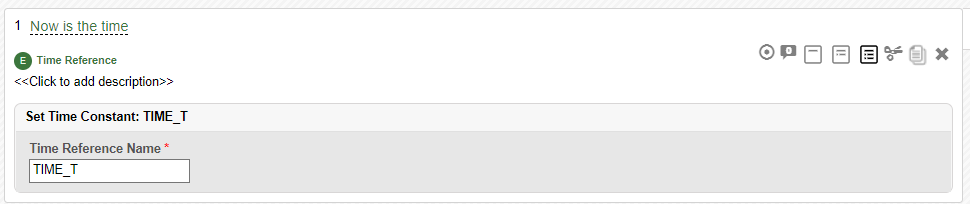

This allows users to specify any number of time references within their procedures. Note that if the same time reference is used (or re-executed) the time reference will be updated.

### Time References (Built In)

Time references represent procedure relative times which are maintained by the execution service and the embedded code. They can be used for any time input that is either untyped (ERT) or typed as ERT/SCET.

| Time Reference Name | Description |
| ------------------- | ----------- |
| `CURRENT_TIME` | This grabs the current time |
| `LAST_STEP_START` | This time is set to the time that the prior step that was executed started. |
| `LAST_STEP_END` | This time is set to the time that the prior step that was executed completed. |
| `LAST_FSW_CMD_STEP_START` | This time is set to the time that the prior FSW CMD step that was executed started. |
| `LAST_FSW_CMD_STEP_END` | This time is set to the time that the prior FSW CMD step that was executed completed. |
| `LAST_SSE_CMD_STEP_START` | This time is set to the time that the prior SSE CMD step that was executed started. |
| `LAST_SSE_CMD_STEP_END` | This time is set to the time that the prior SSE CMD step that was executed completed. |
| `LAST_CMD_FILE_STEP_START` | This time is set to the time that the prior CMD FILE step that was executed started. |
| `LAST_CMD_FILE_STEP_END` | This time is set to the time that the prior CMD FILE step that was executed completed. |
| `LAST_CMD_SCMF_STEP_START` | This time is set to the time that the prior CMD SCMF step that was executed started. |
| `LAST_CMD_SCMF_STEP_END` | This time is set to the time that the prior CMD SCMF step that was executed completed. |
| `LAST_CUSTOM_SCRIPT_STEP_START` | This time is set to the time that the prior CUSTOM SCRIPT step that was executed started. |
| `LAST_CUSTOM_SCRIPT_STEP_END` | This time is set to the time that the prior CUSTOM SCRIPT step that was executed completed. |

!!! note
    Ingenium's understanding of the "LAST STEP" is the last step it has executed (not the prior step in the procedure).

## Venue Configuration Steps

Many of these steps interface with the Ingenium Venue Configuration.

### Venue Configuration

The Venue Configuration step exists to capture test information that can be highly variable, specifically software and dictionary versions. This information could also be managed via the Venue Configuration (and the Get/Check/Update Configuration steps) but that is up to the project.

All fields accept plain text.

!!! warning "Screenshot needed"
    A Venue Configuration step showing the FSW version, SSE version, FSW dictionary, SSE dictionary and GDS version fields.

!!! info "Content needed"
    The Get Config, Check Config and Update Config steps are not documented in the source.

## Verification Item and Status Steps

See also [V&V Integration](vnv_integration.md).

### Verification Item Step

The Verification Item step allows procedure authors to "declare" that their procedure addresses certain requirements. This information is sourced from [Project Configuration](deployment_and_config.md#verification-items).

Some important things to remember about this functionality:

- The project is responsible for extracting verification items, merging them into the Ingenium format and uploading them to the [Project Configuration](deployment_and_config.md#verification-items) service.
    - If this is not done regularly, Ingenium will get out of sync with the source databases
- When an author "declares" requirements in a procedure, Ingenium stores a copy of the requirement(s) in the procedure (representing the state of the requirement when it was added/modified).
- The Procedure Validation Report uses that information to determine if a requirement has changed from a procedure to the current requirement set.

!!! note
    Verification Items can be "declared" multiple times in a procedure without issue.

Users filter and select requirements via the "Select VIs" modal.

!!! warning "Screenshot needed"
    The "Select VIs" modal showing VAC/VA filters and the list of selectable VIs.

!!! warning "Screenshot needed"
    A populated Verification Item step showing the table of declared VIs.

### Verification Item Status Step

This step allows procedure authors to map Verification Items to executable steps in their procedure. This creates a derived Pass/Fail status for the requirements in question. This can be extracted via the Ingenium V&V report and used to shorten the data review process.

Some things to keep in mind:

- Verification items must be captured in a Verification Item step somewhere in the procedure to be mapped in a VI Status step.
- Remember this is one input to the data review process and should not be relied upon exclusively for determining Pass/Fail.
    - That being said it automates one of the more tedious processes of data review ("bean" counting) and can dramatically shorten/sharpen data review.
- This step is "computed" not executed
    - It behaves like an executable step but is re-computed when an execution is closed.
- Requirements can be mapped multiple times if needed (but this may lead to confusion in data review).

Select verification items to map steps to (note it only lists verification items that have been identified in Verification Item steps).

!!! warning "Screenshot needed"
    The VI Status step's verification item selection (only VIs declared in the procedure are listed).

Select executable steps to map the requirement to.

!!! warning "Screenshot needed"
    The VI Status step's executable step selection.

## Verification Options

Ingenium offers a variety of methods to check measured values during a test against a predict. These methods differ slightly based on the type of information being captured.

### Verification by Count or Number

Some telemetry steps allow the user to filter telemetry based on a set of criteria. For these types of steps Ingenium allows the user to check against the number of results that have passed the filter criteria.

The options or "verification conditions" available are:

- Greater Than
- Less Than
- Greater Than or Equal to
- Less Than or Equal to
- Equal
- Record

If the number of filtered results matches the logical evaluation of the verification condition and the "verification value" the step will be considered "PASS". The only exception to this is the "Record" option which does not accept a "verification value" or perform any logical evaluation and is used to simply capture results.

### Verification of Values

In many cases the user will want to evaluate test data directly against a prediction and Ingenium provides an extensive menu of verification options for this. Ingenium can either evaluate the measured value of the test data or it can evaluate the difference between the measured value and the last time that test data was measured in the procedure (i.e. change or increment). As the test data can take a variety of formats not all of the verification conditions apply to all test data.

!!! note "On Change"
    Note that Ingenium will only track test data that is directly queried by the procedure in question. Example: command steps which perform verification may query telemetry to do so but this does not update Ingenium's tracking of command counter telemetry. A user would need to explicitly query that telemetry via a step like Verify EHA ([Telemetry Steps](#telemetry-steps)).

The method that Ingenium uses to determine the "Change" or "Delta" measurement that is evaluated is `<Current Value> - <Last Observed Value>`.

The options or "verification conditions" available, the verification value inputs required, and the test data that they apply to are as follows:

| Verification Condition | Supports "Change" Verification | Allowed Data Types | Required Verification Value Inputs | Notes |
| ---------------------- | ------------------------------ | ------------------ | ---------------------------------- | ----- |
| Greater Than | Yes | Numeric | 1 | |
| Less Than | Yes | Numeric | 1 | |
| Greater Than or Equal | Yes | Numeric | 1 | |
| Less Than or Equal | Yes | Numeric | 1 | |
| Equal | Yes | All | 1 | Evaluation of Enum/Bool is on the string (not the numeric) |
| Not Equal | Yes | All | 1 | Evaluation of Enum/Bool is on the string (not the numeric) |
| Record | No | All | 0 | Considered "FAIL" if no test data is present. |
| Not Present | No | All | 0 | Considered "PASS" if no test data is received. Not valid for Manual Input/temperature steps. (Effectively the opposite of Record.) |
| Contains | No | String, Enum (EU), Bool (EU) | 1 | Performs a simple string match of the verification value on test data (i.e. if X in Y) |
| Inclusive Range | Yes | Numeric | 2 | |
| Exclusive Range | Yes | Numeric | 2 | |

Numeric includes:

- (EHA) Integer, Unsigned Integer, Float, Time (which is equivalent to a UINT)
- (1553) INT, UINT, FLOAT

### Telemetry Types

There are some complexities related to telemetry types and the DN/EU setting.

- For integer channels that have a DN/EU conversion defined, the telemetry includes both a DN and an EU value.
    - Ingenium will allow the user to interact with either the DN (integer) or EU (float)
- For Enum channels the telemetry includes both the symbolic and the numeric value
    - Ingenium treats this as a DN/EU conversion
    - Ingenium will allow the user to interact with either the numeric (DN integer) or the symbolic (EU string)
- For Bool channels the telemetry includes both the symbolic and the numeric value
    - Ingenium treats this as a DN/EU conversion
    - Ingenium will allow the user to interact with either the numeric (DN integer) or the symbolic (EU string)
