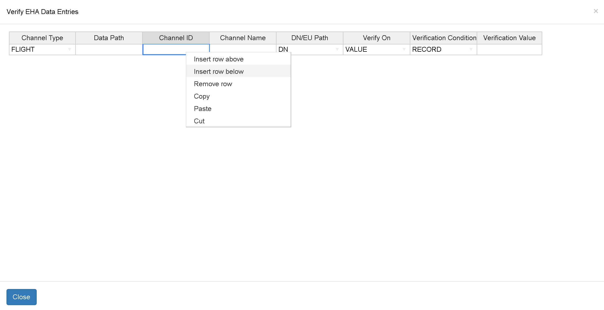
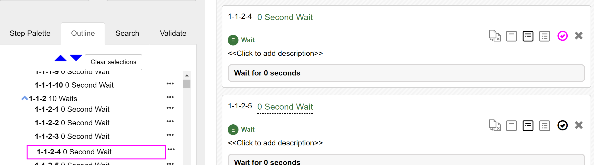
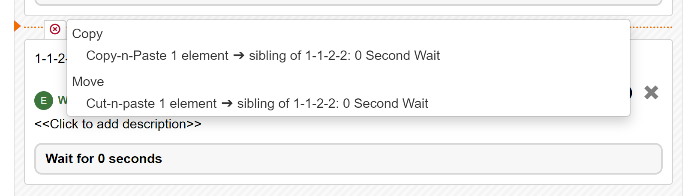
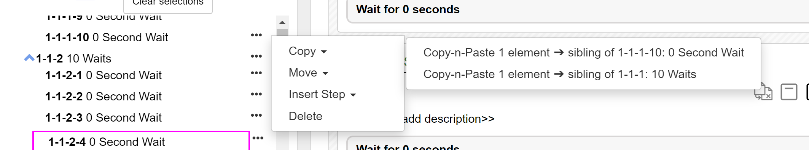
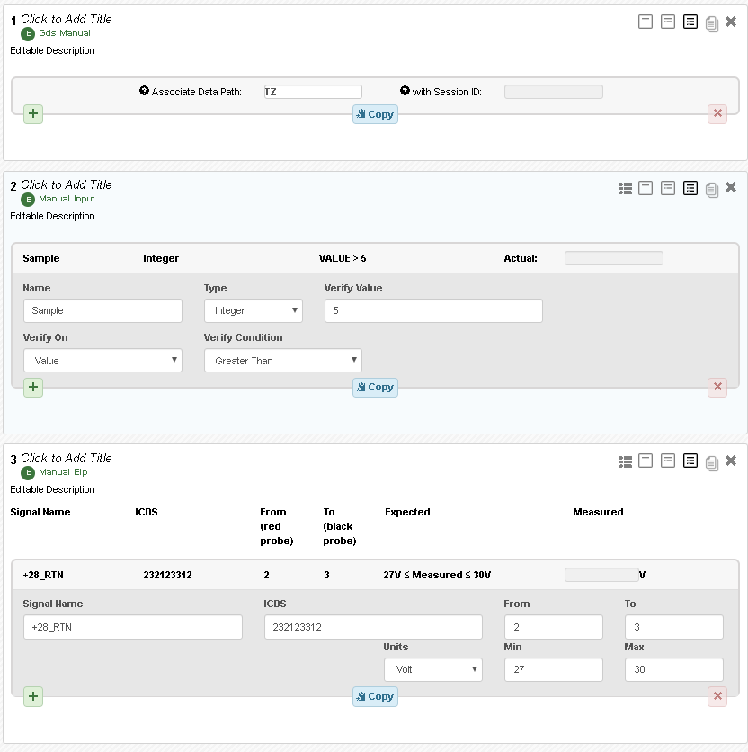
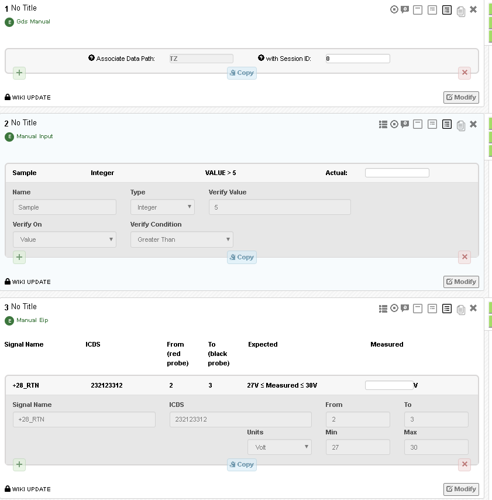

# Editing a Procedure / Execution

## The Palette

The tool palette is on the left side of the screen and contains the following things:

- Controls and information for executing the procedure (procedure execution only). See [Executing a Procedure](executing_a_procedure.md) for more information.
- Controls and information for CM of the procedure (procedure authoring only)
- Dictionary (Flight and SSE) to use when assisting the population of steps
- List of steps to drag onto the workspace. They are color coded to indicate if they are executable or not (green is executable).

!!! note "Dictionaries"
    Dictionaries must be loaded in Ingenium and flagged as "Published" or "Released" to be used by Ingenium. Please note that this only governs the assistance that Ingenium provides for inputting commands and telemetry. The user must ensure that the vehicle is operating under compatible FSW and dictionaries loaded in the ground data system. See [Project Configuration](deployment_and_config.md#flight-sse-dictionaries).

!!! warning "Screenshot needed"
    **Execution** – the palette as shown while executing (execution controls, status, dictionaries, step list).

!!! warning "Screenshot needed"
    **Authoring** – the palette as shown while editing a procedure (CM controls, dictionaries, step list with executable steps in green).

### The Workspace

The actual mechanics of creating/modifying a procedure are fairly intuitive. Drag steps from the palette to the desired location in the procedure. Populate the steps. Note that the same interface exists for authoring procedures and executing them.

!!! warning "Screenshot needed"
    **The Workspace** – the main canvas with several populated steps, showing a step being dragged in from the palette.

### Level of Detail

Ingenium has three levels of detail it can display for each step. These levels are toggled via the icons on the step. Changes to the level of detail of a section will be inherited by all the steps. Some steps are simple enough that they only have detail levels 1 and 2 (e.g. Paragraph step).

| Level | Expected Use | What is Displayed |
| ----- | ------------ | ----------------- |
| 1 | Summary of Content | Step Number, Title, Execution Status |
| 2 | Running/Reviewing Procedures | + Step Description, Summary of Step, Results |
| 3 | Editing Procedures | + Forms to edit content of a step |

!!! warning "Screenshot needed"
    **Example Levels of Detail** – the same step shown at level 1, level 2, and level 3, with the level toggle icons highlighted.

### Break Point

The break point is only available while executing as it allows the test conductor to specify a point in the procedure to halt automatic execution (very similar to a breakpoint in software development). For more on breakpoints and how they interact with the execution please see [Breakpoints](executing_a_procedure.md#breakpoints).

!!! warning "Screenshot needed"
    The breakpoint toggle icon on a step (set and unset).

### Data Grid / Excel Input

Many Ingenium steps allow a series of similar actions to be performed (e.g. send X commands, check Y channels) and these lists often originate in Microsoft Excel. To facilitate their input into Ingenium there is an Excel compatible (or data grid) format for these steps. If this input method is available for the step in question the user is able to click on the data grid icon which will open the step entries in an Excel like interface. This interface supports copying and pasting from Microsoft Excel (assuming the columns align) or the user can directly edit the information here. Changes to the step via the data grid interface are immediately reflected in the step.

!!! note "CTRL+V"
    Users will need to paste via the keyboard shortcuts (e.g. CTRL+V).

!!! warning "Not all Input Validation Available"
    Not all of the validation is available in the data grid interface (specifically the dictionary integration).

### Moving Steps / Sections

Users can move steps (and sections) around in their procedure by clicking the step in the upper portion of the step and dragging the step to the desired location. While dragging, Ingenium will provide an indication of where the step will be inserted if the user drops it.

!!! warning "Screenshot needed"
    A step being dragged, showing the insertion indicator (e.g. the orange line / "Insert as sibling of ..." label).

### Cut/Copy/Paste

The typical cut/copy/paste is accomplished via a two step operation.

Selection of steps:

- Select the steps to copy/cut via the  icon on each step
    - CTRL-Click (multi-select) and Shift-Click (select elements in a range) work as expected.
- Alternatively you can also select via the outline using CTRL/Shift click
- Steps will highlight in both locations when selected

Pasting steps:

- Place your mouse between the steps where you wish to insert the new steps and choose how to insert them.

- Alternatively you can paste via the outline by clicking on the `...` menu and selecting move/copy

Additional information on cut/copy/paste:

- This functionality will work between procedures, between executions, and between procedures and executions
- If entire sections are copied/pasted the hierarchy will be preserved, otherwise content will be inserted as a flat list
- Users can use shift/control click to select ranges of steps / sections
- Users can paste the same content multiple times (by holding ALT) otherwise the clipboard will be cleared after a single paste
- Clicking on the cancel (red x) button in this prompt will discard the copy.

### Comments

!!! info "Content needed"
    The source document marks this section as "Pending updated comment functionality". Describe how to add, reply to and resolve comments on steps. See also [Procedure Review](reporting_and_search.md#procedure-review).

!!! warning "Screenshot needed"
    A step with the comment panel open showing a comment thread.

### When Does Ingenium Save my Work?

Step inputs are saved as soon as a user clicks out of the input field.

### Authoring vs. Execution Fields

Each field on every step in Ingenium is classified as either an "authoring" field or an "execution" field. This controls whether a field can be edited while authoring a procedure and whether or not a field requires a red/blue line to change it when executing it for score. This reflects when certain information is available and when users would be expected to populate this information. Generally the specification of what the procedure is going to do is captured in authoring fields while information that is only available when running the procedure is captured in execution fields.

| Field Type | Editing Procedure | Executing Procedure – Not Run for Score | Executing Procedure – Run for Score |
| ---------- | ----------------- | --------------------------------------- | ----------------------------------- |
| Authoring | Editable | Editable | Disabled (can Redline to edit) |
| Execution | Disabled | Editable | Editable |

!!! note "Running For Score"
    Executing without "Run for Score" enabled will allow the test conductor to freely edit the procedure. This is necessary for procedure development but it is recommended that users familiarize themselves with the steps and what can be edited when "Run for Score" is enabled. See [Running for Score and Redlines](executing_a_procedure.md#running-for-score-and-redlines).

Three common examples are shown below:

- Manual GDS
    - The Session ID (execution) is generated during the test and can't be edited during procedure development.
    - The Data Path (authoring) is part of the procedure specification.
- Manual Input
    - All of the definitions and predicts (authoring) are developed ahead of time
    - The measured value (execution) is only available while running the procedure
- EIP
    - Similar to the manual input example, the specification of what is going to be measured (authoring) is part of procedure development
    - The actual measurement (execution) is only available during the execution

**Authoring**

**Execution (Run for Score)**

## Outline

The outline is a tab on the left side of the screen that allows for rapid navigation, situational awareness, and bulk operations in both procedure development and execution. Each step is listed with its number and title and indented according to the step number hierarchy.

!!! warning "Screenshot needed"
    The Outline tab in the side panel showing the indented step hierarchy with some steps selected.

Operations available on the outline:

- Navigation: click the step/section to navigate to that part of the procedure/execution
- Selection: CTRL-Click and Shift-Click steps to cut/copy/paste

Operations available in the outline menu :

- Copy/Move selected steps
- Insert Steps/Sections
- Delete Steps/Sections
- (Execution only) Toggle Breakpoint

## Review

!!! info "Content needed"
    This section was empty in the source document. Describe the "Review" tab of the side panel (listing/filtering comments). See [Procedure Review](reporting_and_search.md#procedure-review).

!!! warning "Screenshot needed"
    The Review tab in the side panel.

## Search and Replace

The Search and Replace capability is available in the "Search" tab of the side panel.

- Search can be used for procedures and executions
- Replace is available only in the authoring (edit) mode of a procedure. It is not available for a versioned procedure or execution.

!!! warning "Screenshot needed"
    The Search tab of the side panel showing the Search String, Field Filter, step filters, and a list of results with highlighted matches and Replace / Replace All buttons.

### Search

Note that search is a text search. Therefore, "Search String" is required. Search will return up to 1000 matches.

Search results include the step number (with a link), field name, and highlighted matched text. You can navigate to the step by clicking on the step number.

#### Fields

You can specify one or more fields to search for text in "Field Filter". The following fields can be selected.

- TITLE
- DESCRIPTION
- ELEM_TYPE
- STEP_TYPE
- STATUS
- COMMENT
- DATA_PATH
- COMMAND_STRING
- EVR_NAME
- CHANNEL_NAME
- CHANNEL_ID

If no "Field Filter" is selected, all searchable fields will be searched. Below is the list of searchable fields.

| Field | Description | Replaceable |
| ----- | ----------- | ----------- |
| `title` | Element title | true |
| `description` | Element description | true |
| `elem_type` | Element type | false |
| `step_type` | Step type | false |
| `conversations.comments.content` | Comments | false |
| `input.reference_procedure_id` | Procedure id | false |
| `input.reference_procedure_title` | Procedure title | false |
| `input.reference_procedure_institutional_id` | Procedure id | false |
| `input.reference_procedure_institutional_release_id` | Procedure release id | false |
| `input.entries.name` | Manual Input step | true |
| `input.entries.verification_values` | Manual Input step | true |
| `input.entries.actual_value` | Manual Input step | false |
| `input.entries.signal_name` | Manual EIP | true |
| `input.entries.icds` | Manual EIP | true |
| `input.entries.from` | Manual EIP | true |
| `input.entries.to` | Manual EIP | false |
| `input.entries.unit` | Manual EIP | false |
| `input.entries.min_value` | Manual EIP | true |
| `input.entries.max_value` | Manual EIP | true |
| `input.fsw_version` | Venue Config | true |
| `input.sse_version` | Venue Config | true |
| `input.fsw_dictionary` | Venue Config | true |
| `input.sse_dictionary` | Venue Config | true |
| `input.gds_version` | Venue Config | true |
| `input.default_cmd_string` | GDS Manual | false |
| `input.entries.data_path` | GDS Manual | true |
| `input.entries.session_id` | GDS Manual | false |
| `input.entries.config_elem_name` | Get Config | true |
| `input.entries.type` | Get Config | true |
| `input.entries.status` | Get Config | true |
| `input.entries.serial` | Get Config | true |
| `input.entries.notes` | Update Config | true |
| `input.entries.field_name` | Check Config | true |
| `input.entries.verification_value` | Check Config | true |
| `input.evr_name` | Query EVR | false |
| `input.start_time` | Query EVR | true |
| `input.end_time` | Query EVR | true |
| `input.message_filter` | Query EVR | true |
| `input.data_path` | Query EVR | true |
| `input.entries.channel_id` | Verify EHA | true |
| `input.entries.channel_name` | Verify EHA | true |
| `input.entries.bus_1553_var` | Bus 1553 | true |
| `input.entries.evr_name` | Wait EVR | true |
| `input.entries.message_filter` | Wait EVR | true |
| `input.entries.ap_id` | List DP | false |
| `input.entries.product_status_filter` | List DP | true |
| `input.entries.cmd_string` | Cmd | true |
| `input.entries.string_selection` | Cmd | false |
| `input.entries.file_type` | Cmd File | true |
| `input.entries.file_path` | Cmd File | true |
| `input.entries.onboard_path` | Cmd File | true |
| `input.entries.scmf_name` | Cmd SCMF | false |
| `input.script_name` | Custom Script | false |
| `input.script_path` | Custom Script | false |
| `input.script_id` | Custom Script | false |
| `input.hash` | Custom Script | false |
| `input.description` | Custom Script | false |
| `input.inputs.value` | Custom Script | true |
| `input.entries.entry_inputs.value` | Custom Script | true |
| `input.verification_text` | Manual Verification | true |
| `input.analysis_text` | Analysis | true |
| `input.vis.vi_name` | VI | false |
| `input.vis.vi_id` | VI | false |
| `input.vis.vi_text` | VI | false |

#### Filters

Filters can be used to limit the scope of the search to steps that meet the criteria.

| Filter | Description | Available for procedure | Available for execution |
| ------ | ----------- | ----------------------- | ----------------------- |
| Step Type Filter | Type of step | Yes | Yes |
| Step Start Filter | From this step | Yes | Yes |
| Step End Filter | Up to this step | Yes | Yes |
| Step Status Filter | Status of step execution | No | Yes |
| Start Time Filter | Step completed after this time | No | Yes |
| End Time Filter | Step completed before this time | No | Yes |

### Replace

When you are editing a procedure, you can perform text replacement for given search results.

- Replace All: this will replace all replaceable matches
- Replace: you can update a single match. Note that all matches in a field will be replaced.

Note that not all fields are replaceable. For example, you cannot change the execution status of a step. Certain fields that have discrete enum values cannot be replaced to avoid invalid values.

## Procedure Validation

While editing the procedure users can use Procedure Validation via the Validation tab.

!!! warning "Screenshot needed"
    The Validation tab showing a list of detected issues and the automatic "fix" controls.

Procedure Validation can detect the following scenarios:

- New version of procedures
- Missing procedure/version reference
- Missing custom script
- Updated custom script hash
- Updated VIs
- Missing VIs

It can automatically fix the following scenarios:

- Updated VIs
- Missing VIs
- Updated custom script hash
