# Executing a Procedure

## Dashboard

The Dashboard is the primary landing page for all Ingenium users. It is intended to rapidly communicate the current testing activity across all venues that Ingenium manages. It also serves as the jumping off point for starting or watching an execution.

- Clicking on the venue name will bring you to the Venue display that shows its specifics and all the activities run on that venue.
- Clicking "Execute" will start an execution on the specified venue.
- Clicking "Continue Executing" will return a user to an existing execution page.
- Clicking "Watch" will take the user to the current Execution History page so that the user can follow the test execution.

!!! warning "Screenshot needed"
    The Dashboard showing several venues in different states (available, in use, DOWN) with the "Execute", "Continue Executing", "Watch" and "Join" buttons visible.

## Starting (or Watching) an Execution

Starting, continuing, or watching an execution can be initiated via the [Dashboard](#dashboard) or the Venue Details page.

!!! note "There can be only one!"
    Only one person can execute a procedure at a time.

!!! note "Ingenium Keeps Going"
    Once an execution is opened by a user it must be closed by deliberate action (either by the user, or by an Ingenium admin who is able to force executions closed). This is to ensure that procedure execution is not interrupted or adversely impacted by client browser issues or network connectivity. See [Force Closing or Suspending Executions](administration.md#force-closing-or-suspending-executions).

## Core Concepts

- **Ingenium Execution Mode**: Ingenium supports two modes of operation
    - Manual: Ingenium will require a test conductor to click to execute every step
    - Automatic: Ingenium will step through the procedure, in order, executing each step, halting per defined conditions
- **Current Step**: the current step that will be executed next in the procedure.
    - Ingenium advances this cursor as it executes
- **Ingenium Execution Status**: this is the current state of the execution
    - Idle: no steps are executing, Ingenium will not automatically advance or execute
    - Running: a step is executing and/or automatic execution is running
    - Paused: Ingenium has been told to pause the execution at the next opportunity
    - Halted: Ingenium is halting execution (note halting occurs very quickly and it is likely this status is rarely visible)
    - Suspended: the execution was suspended to release the venue. The execution can be resumed on the same venue (if available) or another venue later.
- **Execution Description**: a short summary of the execution (searchable).
    - Useful for capturing a top level description of the contents of the execution.

## Execution Overview

The execution interface has many of the same features as the authoring interface (the Step Palette, the Outline, the Review panel; see [Editing a Procedure / Execution](editing_procedure_execution.md)) but has some important differences:

- Execution Status
- Following and Notification Sounds
- Execution Description
- Execution Controls

## Execution Status

The execution status provides a summary view of the execution including the execution status, the mode, and an overview of the execution progress.

Note that the "Current Procedure" reflects the procedure of the "Current Step".

!!! warning "Screenshot needed"
    The Execution Status panel (Status, Mode, Time Elapsed, Executed Steps, step pass/fail counts, Test Conductors, Current Procedure).

## Following and Notification Sounds

The information at the top of the execution will follow the user as they execute and contains the controls for notifications and automatic following. Following an execution will automatically scroll the screen as the Current Step advances.

Ingenium also provides an option for audio notification for certain events (related to step execution).

Enable or disable it by clicking the sound icon .

Sounds are available for the following events:

- Execution Paused
- Step Fail
- Step Error
- Step Passed

!!! warning "Screenshot needed"
    The execution header bar showing the sound notification selector and the "Follow" toggle.

## Execution Description

!!! info "Content needed"
    This section was empty in the source document. Describe where to enter/edit the execution description and how it is used when searching executions (see the description examples in [Configure the Execution](#configure-the-execution)).

!!! warning "Screenshot needed"
    The execution description field at the top of an execution.

## Execution Controls

Ingenium is capable of executing in either manual mode (test conductor executes each step) or in automatic mode (Ingenium steps through the procedure, halting for pre-defined conditions).

### Manual Execution

Every execution starts in manual mode. To execute steps in this mode the test conductor selects the current step  and then clicks either the play button or the execute icon  on the current step.

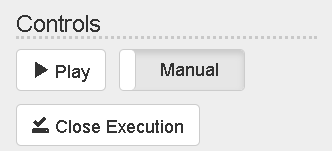

!!! note "No Current Step Selected"
    If no current step has been selected (e.g. at the start of an execution) Ingenium treats the first step in the execution as the current step.

The step will then begin to execute and a message window will appear indicating the step execution progress. Note that Ingenium can only execute one step at a time and while a step is executing the execution controls are disabled.

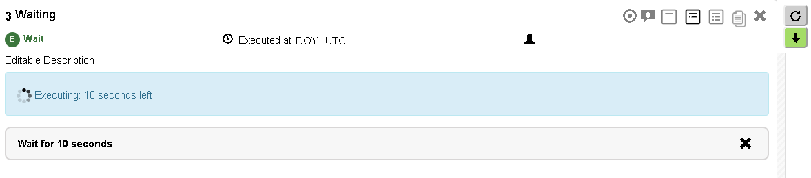

Once the step has executed it is time tagged and given a status (PASS, FAIL, ERROR) and Ingenium advances the current step to the next step in the procedure.

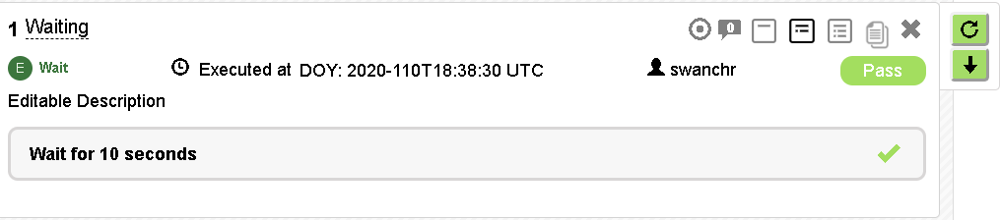

### Re-Executing a Step

Ingenium allows users to re-execute steps. This is performed by clicking the re-execute button 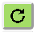 and confirming the action.

!!! note "Re-Execution Display"
    While Ingenium stores every execution of every step, it can only display the most recent execution results.

### Overriding the Status of a Step

Test conductors can override 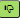 the Ingenium status of a step (with justification). "Pass" is overridden with "Override Fail", "Fail" is overridden with "Override Pass".

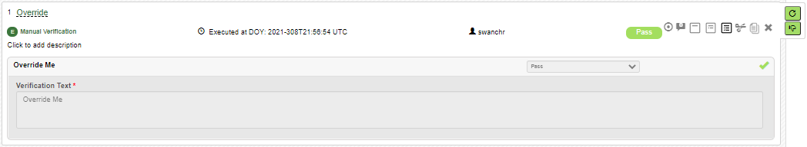

!!! warning
    The status of "Error" can not be overridden.

### Automatic Execution

Automatic execution operates in a similar manner to manual except that once started it will continue until stopped or a pre-defined condition is met.

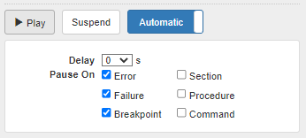

Automatic execution will automatically pause if it encounters:

- A step requiring input (execution input)
- A step that has already been executed

Automatic execution can optionally pause if it encounters:

- A step that resulted in an Error status
- A step that resulted in a Fail status
- A step marked as a breakpoint (checked by default)
- A section boundary
- A procedure boundary
- A step that is considered a "Command Step" (including FSW/HDW/SSE/SCMF/File Uplink and Custom Scripts)

Users can also add a slight delay in between each step so that results can be observed before Ingenium proceeds to the next step.

!!! note
    If the execution is IDLE and the play/lightning bolt icon is pressed Ingenium assumes that the user's intention was to execute the current step (even if that step requires manual input which has not been populated yet).

### Breakpoints

Breakpoints are user specified points in the procedure where automatic execution will halt. They are very similar to breakpoints in code execution.

Breakpoints are toggled via the breakpoint icon on individual steps. They are also visible via the outline and a user can clear all breakpoints via that interface.

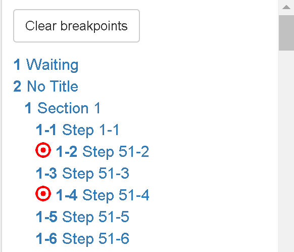

## Stopping the Procedure

There are two methods to stop the execution of a procedure when a step is running.

!!! warning "Screenshot needed"
    The execution controls while a step is running, showing the Pause and Halt buttons.

### Pause

The procedure execution can be paused which transitions the procedure state from "Running" to "Idle". These actions stop the execution of additional steps but do not affect any step currently executing.

A procedure can be paused in the following ways:

- Pressing the Pause button
- Transitioning the procedure mode from automatic to manual
- Pausing due to conditions identified above in [Automatic Execution](#automatic-execution)

### Halt

Halting an execution will force quit any step that is currently executing and pause the procedure. This will typically result in that step having an "ERROR" status.

!!! warning "Halting Doesn't Stop the Spacecraft"
    While halting the execution will prevent Ingenium from taking additional action it does nothing to the spacecraft under test.

## Closing the Execution

Once the execution has completed it can be closed via the Close Execution button. The user will then be presented the procedure as a read only as-run. Please note that once a procedure is closed it can not be opened again. If your execution is not done and you have to release the venue to the next shift, you can suspend the execution as explained below.

!!! note "Closed?"
    Closing a procedure does not require closing GDS or shutting down the testbed. There may be reasons to keep the testbed running independent of that execution. Examples:

    - The next test requires a similar configuration (which takes time to reach)
    - To create a more focused as-run of an individual procedure (vs. multiple procedures run in one execution)
    - The user was dry-running a procedure and wanting to make edits and re-run it

    Be sure to mind the configuration of the underlying hardware/simulation.

## Suspend/Resume

Sometimes it is desirable to suspend an Ingenium execution and then resume it at a later date. This has a number of use cases including:

- Release the test venue to the next shift without closing the execution. You can resume it later when the venue is available again.
- Transfer of test conductor
- Work on procedure execution ahead of time (e.g. pre-redlines)

The suspend/resume capability allows creating a single execution record (as-run) that was executed over multiple shifts.

### Suspend

To suspend an execution simply press the "Suspend" button in the execution controls.

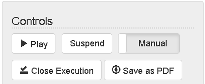

This will save off the execution and the running state of the execution. This includes things like Data Path, Time Constants (e.g. `LAST_STEP_START`), and recent telemetry measurements.

### Resume

Executions can be resumed from the "Executions" page and will show up with a status of "SUSPENDED".

!!! warning "Screenshot needed"
    The Executions page showing an execution with status "SUSPENDED" and its "Action" menu expanded with the "Resume" option.

!!! note "Execution Status"
    Some executions may have IDLE status. That means the execution is still open but there is no step that is currently running.

    - You can suspend only an IDLE execution. When a step is running, you cannot suspend the execution. Wait until the step execution is done or halt the execution before suspending it.
    - You can resume only a SUSPENDED execution.

Users can resume the execution via the "Action" menu on the right side of the table. This will prompt the user to select which venue to resume the execution on.

!!! warning "Screenshot needed"
    The Resume dialog prompting the user to select a venue.

!!! tip "Execution Description"
    Please populate the execution description or you will have difficulty locating your execution!

Please note the following:

- Ingenium will default to the last venue the execution was run on (if available)
- Ingenium will not allow users to resume on a venue that
    - they lack access to
    - is not currently available
- Any user with an execute permission can resume any execution

!!! warning "Resuming"
    Resuming an execution does rely on the test conductor to re-establish the correct state of the vehicle and re-sync the execution to that state. This likely includes re-running steps or running additional steps to configure the venue to the state the execution left off. It is very likely that you will need to run the Manual GDS step again to re-establish the data path to the correct session ID (if you started a new GDS session).

### Transfer of Test Conductor

Transferring the active test conductor involves two actions:

- Action 1: the current TC suspends the execution
- Action 2: the next TC resumes the suspended execution

### Multi-User

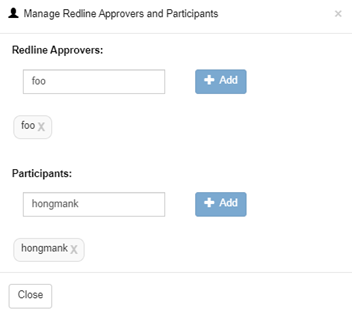

The Ingenium Test Conductor can invite other users to participate in an execution.

- Redline Approvers: can approve redlines
- Participants: can add steps, create redlines, input data into steps
    - Can not execute steps

Note that the Redlines permission has been replaced with this system and all Ingenium Test Conductors can self approve their own redlines.

After a user is invited a new "Join" button appears on the dashboard. Clicking that link will bring you to a version of the watch/execute pages that corresponds to the participant level.

!!! warning "Screenshot needed"
    The Dashboard venue entry showing the "Join" button for an invited user.

## How to Start an Ingenium Execution

### Select Venue

- Log in to Ingenium
- On the Ingenium Dashboard screen, select which venue you are going to be executing the procedure on and click Execute
    - If a simulator server hosts multiple venues (e.g. "a" and "b"), it doesn't matter which one you choose
    - You may have assigned WSTS machines and/or scheduled testbed timeslots. Please adhere to those.

!!! warning "Screenshot needed"
    The Dashboard with the "Execute" button highlighted for a venue.

### Configure the Execution

- Once you click Execute, it will take you to a new screen
- One of the first things you should do is fill in a Description of what you will be testing

!!! tip
    Try to make the Description clear and concise because it will help you later when searching through all of the Executions. Examples:

    - P1234: Run For Score - Completed Sections 1 - 8 to verify FP responses.
    - P1234: Dry Run - Completed entire procedure in preparation for execution in the Testbed.
    - P1234: Development Work - Executed section 10 - 16 to refine procedure prior to release.
    - DELETE ME - Did not execute anything

!!! warning "Screenshot needed"
    A new execution page with the Description field being filled in.

- After filling in the Description, you may need to choose the SSE and Flight Dictionary version
    - Selected dictionaries are used only when you modify an existing step or when you create a new step directly in the execution. Basically selected dictionaries are an aid for authoring steps.
    - When a step is executed, Ingenium will send whatever command or telemetry definitions are in the step to the venue. The venue will use whichever versions of flight and SSE dictionaries GDS was started with on the venue.
    - Make sure that you start the venue (WSTS, Testbed, ATLO) with the same dictionary versions your procedure was authored with.
    - If either the venue or Ingenium are missing dictionaries make a request that they be added

!!! warning "Screenshot needed"
    The Flight and SSE dictionary selectors in the execution palette.

- To start running a procedure, click on the [Run Procedure Step](built_in_steps.md#run-procedure-step) and drag it to the top of the execution field (which is the area in gray)
    - When done correctly you will see an orange line with a smaller gray box that says "Insert as sibling of 0"

!!! warning "Screenshot needed"
    Dragging the Run Procedure step into an empty execution, showing the orange line and "Insert as sibling of 0" label.

- Next click the Lookup button to select which Procedure to run
    - Use filters to help find the procedure you want to execute

!!! warning "Screenshot needed"
    The Procedure Lookup dialog with filters applied.

- After selecting the Procedure, click the Lookup button to choose which Version of the procedure to run
    - For Testbed or ATLO venues, you should typically only choose RELEASED procedures as they have been approved through your project's procedure approval process
    - For WSTS, you can choose any version

!!! warning "Screenshot needed"
    The Version Lookup dialog listing procedure versions and their release status.

- After selecting the Version, click the Choose button to choose which Sections of the procedure to run

!!! warning
    Be mindful when skipping steps as they could have impacts on your test!

!!! warning "Screenshot needed"
    The section/step selection modal opened via the Choose button.

- After the Procedure, Version, and Sections have all been selected, determine whether this execution will be Run For Score or not and then click Run

!!! warning "Screenshot needed"
    A fully populated Run Procedure step with the "Run for Score" checkbox and "Run" button highlighted.

### Run the Procedure

- There are two execution modes
    - Manual: the user has to click each step individually in order to progress in the procedure
    - Automatic: can be configured several different ways

!!! tip
    If you are unfamiliar with a procedure it is probably better to run in Manual mode until you understand everything that is taking place in the procedure.

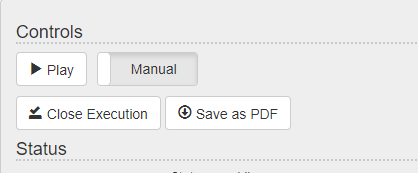

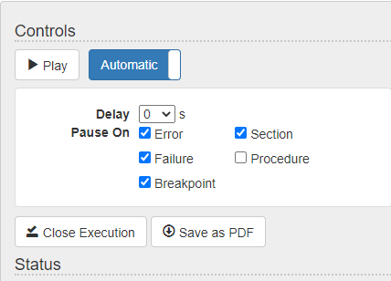

### Close the Execution

- When you are done testing remember to Close the Execution
    - This is also a good time to go back and update the Description in case you deviated from the original plans
    - Example: "Development Work - Aborted test after Section 6 due to many dictionary issues"

!!! warning "Screenshot needed"
    The "Close Execution" button and the confirmation prompt.

## Running for Score and Redlines

### Overview

It is important for Ingenium to be able to capture any tactical changes to an approved procedure. These changes are called Redlines and are enforced when a user chooses to run a procedure as "Run for Score" or "Run for Record".

#### Types of Redlines

There are two types of changes which are both supported by Ingenium.

- **Redlines**: a permanent change to the procedure that should be reflected in the configuration controlled version.
- **Bluelines**: a change to the procedure because of the specific circumstances of the test. Will not be reflected in the configuration controlled version.

Please note that these are functionally identical from Ingenium's perspective and this documentation generically refers to both as "Redlines".

### Input Phase: Authoring vs. Execution

Each input field in an Ingenium step is categorized as either "Authoring" or "Execution". This aligns to whether a field is under CM ("Authoring") or is expected to be populated during an execution ("Execution"). Please see [Authoring vs. Execution Fields](editing_procedure_execution.md#authoring-vs-execution-fields) for more information and examples.

### Running for Score

As it is not always desirable to enforce the formality of Redlines, Ingenium relies on the test conductor to indicate that they are needed. This is done on a per procedure basis and is selected as part of the [Run Procedure Step](built_in_steps.md#run-procedure-step). If "Run For Score" is selected, Ingenium will enforce Redlines within the execution of that procedure. Please note that Ingenium does not force Running for Score or limit it to officially released procedures. It is expected that this will be governed by project and institutional process and policy and will likely vary by test venue.

!!! note "Run for Score is Inherited"
    If you import a procedure as "Run for Score" and it references other procedures, those will also be treated as "Run for Score".

!!! tip "Dry Run – Run for Score"
    It is recommended that users, especially newer ones, dry run their procedure with Run for Score enabled.

#### Impacts to Steps

When a procedure is imported as "Run for Score" the following things change for steps in that procedure:

- "Authoring" phase fields are disabled (and can't be edited without a Redline)
    - See [Built-in Steps](built_in_steps.md) for information on input field phases
- The step has a lock/unlock indication in the lower left
    - Locked means that the step is Run for Score and will require a Redline to change
- The step has a "Modify" button in the lower right
    - Clicking this will initiate a Modify Redline

!!! warning "Screenshot needed"
    A Run for Score step showing the lock icon (lower left) and the "Modify" button (lower right).

### Redline – Modify

When a user initiates a "Modify" Redline the following things happen:

- The original step (in the example below 10-2) is disabled (you can not execute the original step if a redline is present)
    - If the step already was executed, it can't be re-executed.
- A new step is created based on the original step using the numbering convention `<original>.<a-z>`
- All input fields of the Redline step can be edited and the lock icon (lower left) shows open
- The Redline icon appears in the lower right.
- The modified step (10-2.a) can not be selected or executed (see grey cross hair icon) **as Redlines can not be executed until they are approved**.

!!! warning "Screenshot needed"
    Example of a Modify redline: original step 10-2 (disabled) and the new redline step 10-2.a with the open lock, Redline icon, and grey cross hair.

- Clicking on the Redline icon will expand the step to show the Redline justification and approval.
- The test conductor will populate the justification and any approvals required.

!!! warning "Screenshot needed"
    The expanded Redline justification and approval panel.

- Once populated the Redline can be approved
    - The input fields are locked (unless they are expected to be input by the TC)
    - The lock icon in the lower left goes to locked
    - A green check mark appears next to the Redline icon, indicating that the redline is approved
    - The cross hair icon turns green and the step can be executed.

!!! warning "Screenshot needed"
    An approved redline step showing the locked icon, green check mark next to the Redline icon, and green cross hair.

### Redline – Add

Adding steps to a "Run for Score" procedure will result in an additional step with the numbering `<prior step>.<1...N>`.

Aside from the difference in numbering, the process and mechanics for this type of Redline are identical to what was described above.

!!! warning "Screenshot needed"
    An added blueline step (numbered e.g. 10-2.1). The original text refers to "Blueline is shown above".

!!! note "Redline vs. Blueline"
    Redlines vs. Bluelines are purely cosmetic from Ingenium's point of view.

### Redline – Delete

A Redline deletion is initiated via the "x" icon in the upper right of the step. This will:

- Put "DELETED" at the top of the step
- Cross out the title of the step
- Disable execution for the step

It is approved via the same mechanics as modifications and additions.

!!! warning "Screenshot needed"
    A step marked for deletion by a redline ("DELETED" header, crossed out title).

### Redline – Discard not Delete

Redline steps cannot be deleted. If the user decides to not execute a redline it must be discarded via the Redline menu.

!!! warning "Screenshot needed"
    The Redline menu showing the "Discard" option.

!!! note
    Approved Redlines cannot be discarded. Redlines must be unapproved prior to discarding.

### Redlines – In Bulk

Redlines can be added in bulk (additions) via copy and paste. They can also be modified/approved in bulk.

On the initiation of any redline (including multi-step paste operations) a dialog will be displayed to enter the justification for all redlines (and the type).

!!! warning "Screenshot needed"
    The bulk redline justification dialog (justification text and Redline/Blueline type).

To approve/modify redlines en masse the user first selects the redlines via the toggle button on each step.

!!! warning "Screenshot needed"
    The redline selection toggle on a step.

The selected red/bluelines can then be modified or approved via the menu on the tool palette.

!!! warning "Screenshot needed"
    The tool palette menu for modifying/approving selected redlines.

### Redlines – Diffs

Modification red/blue lines will display the differences between the original step and the red/blue line. Because multiple modifications can occur (and because of UI performance) this display is limited to one red/blue line pair (defaults to the most recent). To control which differences are displayed the user can toggle them via the "Diffs On" button on the redline.

!!! warning "Screenshot needed"
    A redline step with "Diffs On" showing highlighted differences from the original step.

### Redline – Limitations

- Users cannot cut and paste within Redline procedures (they can copy and delete)
- Users can not move steps within a Run for Score procedure
