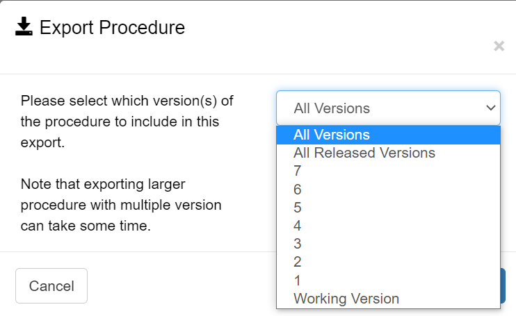

# Importing and Exporting

## Introduction

Ingenium has a number of ways to import and export content. This is designed to facilitate the transfer of data between Ingenium instances.

!!! warning "Manual Edits of Imported Files"
    Some users may be tempted to edit Ingenium exported files and then import them. Please be aware that doing this is non-trivial and you are most likely going to break things.

## Procedure Version Import/Export (R4)

This capability allows any version of any procedure to be exported, and then imported into the working copy of another procedure. It was initially designed to support ATLO file migration, but the loss of procedure metadata and the difference in IDs (as procedures had to be re-created) resulted in the [Procedure Import/Export](#procedure-importexport-r12) capability. Now that the procedure import capability is available, this capability's primary use case is to transfer a procedure (version) from one project to another (as the working version).

To Export:

1. Navigate to a procedure
2. Select the version to export
3. Click Export (a tar.gzip file will be downloaded)

!!! warning "Screenshot needed"
    The procedure version history table with the "Export" action for a numbered version highlighted.

To Import:

1. Navigate to a procedure
2. Click Import (on the Working Version)
3. Select an Ingenium procedure version export file (tar.gzip)

!!! danger
    **This will overwrite the working version.**

!!! warning "Screenshot needed"
    The "Import" action on the Working Version and the file selection dialog.

## Procedure Import/Export (R12)

This capability is designed to selectively mirror procedure content from one Ingenium instance to another. The primary use case is to migrate procedures from Testbed Ingenium servers to ATLO Ingenium servers on a separate (e.g. mission) network.

This method will retain the original Ingenium procedure ID.

To Export:

1. Navigate to the procedure page
2. Locate the procedure to export and click the menu button to access the export option
3. Select the versions to include in the export (All, Released, Individual)
4. Click Export (a tar.gzip file will be downloaded)

To Import:

1. Navigate to the procedure page
2. Click Import
3. Select an Ingenium procedure export file (tar.gzip)

!!! warning "Screenshot needed"
    The "Import" button on the Procedures page and the file selection / import confirmation dialog.

!!! danger
    **This will update the procedure with a corresponding ID.**

    - Procedure metadata will be updated
    - Any versions included in the import will overwrite the corresponding content on import

## Execution Import/Export (Future)

This capability is designed to selectively mirror execution (as-run) content from one Ingenium instance to another. The primary use case is to migrate as-runs from ATLO Ingenium servers on a separate (e.g. mission) network to Testbed Ingenium servers to make as-runs more available.

!!! note "Open Ingenium Note"
    This capability has not been implemented yet. It was tracked in an internal ticket (ING-3669 – Import/Export Executions).
