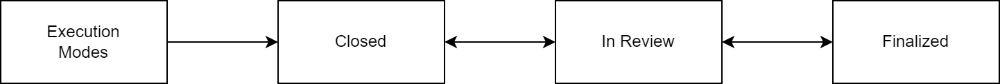

# Reporting and Search

## Reporting

### Reporting Overview

You can request a difference ("diff") report for procedures and executions. Reports are generated by the Reporting service on the Ingenium Analytics Server (see [Architecture](../architecture.md#reporting)).

### "Diff" Report

To see differences between procedure versions or executions, use the "Difference Report". You can compare:

- Procedure versions of the same procedure
- Procedure versions of different procedures
- Executions (as-runs)
- A procedure version and an execution

To generate a diff report:

- Select a source procedure (and version) or an execution
- Select a target procedure (and version) or an execution
- Click the "Difference Report" button
- You will receive a confirmation email when you submit the request
- When the report is available, you will get another email with a download link to the report in PDF format. It may take seconds to minutes to generate the report depending on the contents.

!!! warning "Screenshot needed"
    The Reports page with a source and target selected and the "Difference Report" button.

Below is an example of a difference report.

!!! warning "Screenshot needed"
    An example page from a generated Difference Report PDF showing highlighted differences.

## Search

### Introduction

Ingenium has the capability to search across all procedures and executions via complex queries to support detailed data reviews and investigations. This information is cached in a performant database (Elasticsearch) and is available within minutes of changes to procedures/executions.

### Search Capabilities

Users can construct a query using a combination of query fields, AND/OR logic, and a single compound condition. These queries can be limited to procedures or executions (or both) and will return up to 10,000 matches to the query parameters.

!!! warning "Screenshot needed"
    The Search page query builder with several query terms, AND/OR logic, and the procedure/execution scope selector.

Query terms fall into two categories: Text and Numeric.

- Text term operators include: Contains, Does Not Contain
- Numeric term operators include: equal, not equal, greater than, less than, greater than or equal, less than or equal

Each search term has "hints" that can help users with proper formatting of queries:

!!! warning "Screenshot needed"
    A search term with its formatting "hint" displayed.

You can create one compound condition and combine it with other queries.

!!! warning "Screenshot needed"
    **Compound Condition** – the query builder with the compound condition highlighted (the original showed it in a red box).

Each search result includes a link to the step in either the procedure or execution (depending on where the result was found).

!!! warning "Screenshot needed"
    Search results showing links to matching steps in procedures/executions.

!!! note "Search Includes All Step Executions – UI Displays Most Recent"
    Note that the search capability includes all step executions but the Ingenium UI is limited to displaying a single step execution (the most recent). This can lead to scenarios where a search result may not match what is displayed in the execution as there is more than one execution of the step. Users should utilize either an Integrated Report or PDF export to see all executions.

### Saving, Sharing, Restoring Queries

Searches can be saved (per user), restored, and shared with other users.

Saving searches (query terms) is accomplished via the save icon and basic information.

!!! warning "Screenshot needed"
    The save search icon and the save dialog (name/description).

Saved searches can be restored, deleted, or shared with other users via a unique URL.

!!! warning "Screenshot needed"
    The saved searches list with restore, delete and share (URL) actions.

## Procedure Review and As-Run Review and Closeout

### Procedure Review

Users can provide feedback via comments on individual steps on read only versions of a procedure (e.g. not the working version). Total numbers of comments and unresolved comments are available at the procedure level.

**Total comments:**

!!! warning "Screenshot needed"
    The procedure version table showing total / unresolved comment counts.

**Example:**

!!! warning "Screenshot needed"
    A step on a read only procedure version with a comment thread.

Users can rapidly search for comments within procedures via the "Review" left panel and via the Comment filter.

!!! warning "Screenshot needed"
    The "Review" left panel and the Comment filter.

!!! note "Comments Not Available on Working Version"
    Commenting on the working version is not supported.

### As-Run Review and Closeouts

#### As-Run Review

Review of procedure as-runs (often called executions in Ingenium) is handled via an expanded system of comments, similar to what is available in procedure review.

An overview of comment totals is available via the list of executions.

!!! warning "Screenshot needed"
    The Executions list showing comment totals per execution.

As-run comments have additional options.

!!! warning "Screenshot needed"
    The as-run comment dialog showing the comment category options (General, Activity Report, Data Review / Closeout).

##### Summary Comments

- Activity Report and Data Review / Closeout comments have the option to capture an execution wide summary comment that is not directly connected to a specific step.
- These can be used to capture review of the overall execution.

!!! warning "Screenshot needed"
    An execution wide summary comment.

##### Activity Report / Data Review and Closeout Comments

Two separate categories of comments are available for review of procedure as-runs. They operate identically to the general comments but can be filtered/searched for separately. Projects can define their own usage approach to these categories but the Ingenium recommendation is to use these comments as follows:

- Activity Report Comments: use to capture information/actions that occur during or stem from the execution of the procedure.
    - Example: identify steps connected to potential problem/failure reports for further analysis
- Data Review / Closeout Comments: use to capture post test review and analysis. V&V review for Testbed executions, procedure closeout for ATLO executions.
    - Example: add information to disposition a failed execution of a step (e.g. telemetry query)

##### Filtering

Filtering on comments is available via the filtering menu in the hover menu. The filter results are visible in the main canvas area and via the outline.

!!! warning "Screenshot needed"
    The comment filtering menu and the filtered results in the canvas and outline.

#### As-Run Closeout

Ingenium has a basic workflow to close out as-runs.

Execution modes include states like IDLE, SUSPENDED, etc.

- Closed
    - A closed execution can not execute any more steps
    - Once closed the execution can not be re-opened
    - Expected to occur at the end of a test
- In Review
    - Entered by clicking on "Approve As-Run"
    - Users can comment, override pass/fail of steps
    - Expected to occur when test session actions are completed
- Finalized
    - Commenting disabled
    - Only Ingenium admins can transition back to In Review
    - Expected when data review / closeout actions are complete
