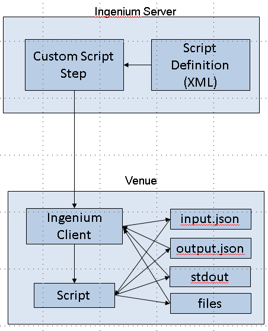

# Custom Scripts

## Why Use Custom Scripts

Custom scripts allow projects to extend Ingenium step functionality for project specific purposes. This could be necessary for a variety of reasons:

- Steps to perform **project unique actions**
    - Ingenium is a multi-mission tool and can not directly support individual project use cases
- Steps to perform actions that have not been implemented in Ingenium
    - While Ingenium can perform most of the common actions in a procedure, we will never capture everything that I&T teams need.

### Custom Script Examples

- Analyzing the content of data products
    - Data products are typically mission unique and generically analyzing them could be challenging.
    - Analyzing a specific data product for a specific project is much easier
- Testbed/WSTS rapid start and configuration
    - Most projects have elaborate "startup scripts" to rapidly configure the vehicle to certain test configurations.
- Performing post processing or analysis on outputs
    - Query telemetry for the test to see if any ground alarms triggered
    - Measuring command rate by averaging EVR times
- Implementing looping or other logic in procedures
    - Ingenium does not support logic or looping within procedures. Use custom scripts to perform loops.

## Custom Script Management

Custom scripts are managed under Project Configuration → Scripts (see [Project Configuration](deployment_and_config.md#custom-scripts)).

They are added/modified via uploaded XML files like other Project Configuration content.

This content allows the Ingenium user interface to build a dynamic set of inputs and outputs around each custom script.

## Using Custom Scripts

Please refer to [Custom Script Step](built_in_steps.md#custom-script-step).

## Custom Script Components

To implement a custom script it is necessary to deliver two separate (but related) products:

- The custom script that runs locally on the client machine where the Ingenium agent is located
- The script specification file which is loaded into the Ingenium project server

## Script Rules

1. Ingenium will invoke each script with two arguments:
    1. The path to the script inputs
    2. The path to the script outputs
2. Ingenium will expect input in a file called `input.json`
3. Ingenium will expect output in a file called `output.json`
4. Ingenium will relay the following back to the user interface:
    1. Any information published to stdout (via real time messages)
    2. Any information saved to the output file (as it is updated)
    3. The contents of the temporary directory (when the script completes)
5. Ingenium does not restrict the language the custom script/application is written in, as long as it complies with the rules
    1. Ingenium provides reference implementations of scripts and utility libraries in Python

## Script Location

Scripts should be placed in the project defined directory on each venue computer. This can vary across the different project venues (e.g. different location for ATLO vs. Testbed).

This is configurable per project on installation (see [Ingenium Custom Scripts Directory](deployment_and_config.md#ingenium-custom-scripts-directory)). Please work with the Ingenium team to define the best location for your project. This location should have limited access.

This should align with the project's approach to configuration management of the scripts (e.g. a local git repository).

## Cyber Security

The custom script functionality allows for remote code execution on the Ingenium venue. Because of the inherent cyber security risk the following protections are used:

- In use custom scripts are stored in a limited access location on the venue
- Each custom script is registered with Ingenium, including a unique SHA256 hash
- Prior to execution of any script, Ingenium will confirm the unique hash
- Projects will review and approve any scripts

## Project Responsibility

While the Ingenium team is happy to support projects as they create custom scripts, the script content is inherently the responsibility of the project.

Projects should have review, approval, and configuration management processes in place.

Projects should restrict access to Ingenium, specifically the `admin`/`config_mgmt` permissions which can modify custom scripts.

!!! tip "GitHub is your friend"
    GitHub (or another git server) is an ideal place/method to manage your project scripts.

## Custom Script Elements

### Custom Script Architecture

Custom scripts execute as follows:

- Ingenium dynamically creates a user interface for a custom script based on the provided script definition file
    - These are loaded into [Project Configuration](deployment_and_config.md#custom-scripts) and define all the inputs and outputs of the script
- When executed, the Ingenium client creates a temporary directory, builds the `input.json`/`output.json` files and executes the script in that directory.
    - Prior to doing this the Ingenium client compares the SHA256 hash of the script with the one provided in the script definition file
- The script executes and Ingenium monitors the `input.json`/`output.json` files (updating the server if they change) and monitors stdout/stderr, relaying it to the Ingenium server in real time.
- Once the script completes the Ingenium client compresses the contents of the temporary directory and uploads it to the Ingenium server (for reference)



### Script Specification File

Each custom script requires a specification file in XML format, which defines the script inputs and outputs.

That file format is captured [here](https://github.com/OpenIngenium/ingenium-lib/blob/main/reference/custom_script_schema.rnc){target="_blank"}.

Script developers can utilize an XML editor like oXygen or a text editor to develop these files.

Note that this format is mirrored in the expected input/output to the custom script itself.

#### Input / Output Structures

These structures provide a framework to capture a diverse set of inputs and outputs sufficient to replicate all current Ingenium built-in steps.

The specification is captured in XML and then must be followed in the input/output JSON structures.

##### Inputs

Inputs to the overall custom script.

Defines:

- Input name / description
- Optional vs. Required
- Whether they are "Authoring" or "Execution" phase inputs
    - Determines if they should be populated during procedure development or execution
    - See [Authoring vs. Execution Fields](editing_procedure_execution.md#authoring-vs-execution-fields) for a more detailed description of Authoring vs. Execution phase inputs
- Default value for the input (optional)
- Input Type
    - Integer
    - String
    - Float
    - Enumeration (with enumeration defined)
    - Data Path
        - Ingenium will take the data path provided (e.g. "TZ-A") and provide the custom script the corresponding session id.
    - Time
        - Ingenium will evaluate time constants (e.g. `CURRENT_TIME`) and provide the custom script the time in DOY format (e.g. `2020-132T23:02:32.023`)
    - Variable
        - Not currently supported (added for potential future use)
    - Boolean
        - "true" or "false"

##### Outputs

Outputs of the overall custom script.

Defines:

- Output name/description
- Output Type
    - Integer
    - String
    - Float

##### Output Arrays

Defines a variable array of outputs to be displayed in a table. Array outputs have the same characteristics as Outputs but they have an additional field "visible" which indicates if the output should be shown in a table or only in a mouse over.

!!! tip "Best Practice"
    Users should limit the number of elements in the array to approximately 10 and the number of visible columns to 4-5 or the UI could have issues displaying the information clearly.

##### Entries

Entries are sets of inputs and outputs that can be scaled within the set. These are very useful to combine multiple similar actions in the same custom script. Examples include lists of commands to send, telemetry to query, etc.

!!! note "Entry Pass/Fail"
    Entries have their own pass/fail status. (Everything must pass for the overall step to pass.)

###### Entry Inputs

These mirror custom script inputs.

###### Entry Outputs

These mirror custom script outputs with an additional field to indicate which output to display as the result (the rest are available via mouseover on the checkmark  like other steps).

###### Entry Output Arrays

An output array for the individual entry (same characteristics as an Output Array).

### Special Fields

In general the input/output JSON files that the custom script must ingest are JSON variants of the XML definition with the following additional fields:

`input.json`:

- `"username"`: automatically populated by Ingenium. Corresponds to the user name of the person executing the procedure

`output.json`:

- `"custom_script_status"`: the status of the step. Should start as `"PENDING"` and then be populated with `"PASS"`, `"FAIL"`, or `"ERROR"` with the step execution
- `"verification_status"`: (per entry) the status of the entry. Should start as `"PENDING"` and then be populated with `"PASS"`, `"FAIL"`, or `"ERROR"` with the step execution

Examples:

- `checksum_file` reference script
    - Basic script that performs a Linux checksum on one or more files and compares against a predict
- `test_script` reference script
    - Script built to test Ingenium. It just regurgitates the inputs in the outputs but includes examples of all input/output structures.

!!! note "Open Ingenium Note"
    The Ingenium reference custom scripts (`checksum_file`, `test_script`, the `template` files, and the `ingenium_cs` Python package) are being refactored into [Ingenium-lib](https://github.com/OpenIngenium/ingenium-lib){target="_blank"} and may not all be published yet.

Development tricks:

- Remember that custom scripts will be running as application users (not you) so take that into account when considering file permissions.
- Leverage the Ingenium reference libraries if developing in Python
- Program defensively (catch your possible errors, log them, exit cleanly)
- Using git (branches, pull requests, etc.) is highly recommended

## Custom Scripts Step By Step

This example goes through the development of a custom script using Python.

### Scope the Script

What is the goal for this script? Can you write a 1-2 sentence description of it that other engineers will understand?

Please keep in mind the use cases outlined in [Why Use Custom Scripts](#why-use-custom-scripts). Think about your script idea: is it specific to you? Will others use it? Could you make an outline of it (step by step)?

### Setup in Git

Find the project git repository you need to use and clone the repository to your computer. Create a folder in the custom script location that matches your script name (no spaces). Create a branch in the repository to hold your initial script.

### Define the Inputs and Outputs

Create three files in your custom script folder: `custom_script.xml`, `input.json`, `output.json` (templates are provided with the Ingenium reference scripts).

These fields are described in [Custom Script Elements](#custom-script-elements).

They should be consistent with each other.

### Time to Code!

Copy the Python template (`template.py`) into your custom script directory and rename it to match `your_script_name.py`.

#### Imports and Virtual Environments

Ingenium recommends that each project (or team) provide a Python virtual environment to run your custom scripts.

This allows the installation of Python packages that aren't included with the default GDS installation of Python.

Most importantly, the Ingenium provided library for custom scripts (`ingenium_cs`).

##### Tell your Script to use the virtual environment

Direct your script to the virtual environment using the shebang line.

```python title="Shebang"
#!/proj/<your_project>/venv3/bin/python
```

##### Imports

Import the functions you need for your script. This includes built-in or other 3rd party libraries.

Note that the order you import the Ingenium library matters (import `ingenium_cs.script_utils.utils` last) as this impacts logging.

```python title="Imports"
# Note that the import order is important here (otherwise the logging doesn't work)
from ingenium_cs.script_utils.ing_venue_utils import get_eha, get_evr, send_fsw_cmd, start_mtak
from ingenium_cs.script_utils.chill_utils import query_evr
from ingenium_cs.script_utils.utils import get_input_output_paths, read_input_file, write_output_file, custom_script_log
```

#### Read the Input Files

The first thing to do is read the input files.

```python title="Read the Inputs"
error_msg = 'USAGE: python sequence_epoch.py input_file_path output_file_path'
input_file_abs_path, output_file_abs_path = get_input_output_paths(error_msg)
custom_script_log.info('input_file_abs_path: %s' % input_file_abs_path)
custom_script_log.info('output_file_abs_path: %s' % output_file_abs_path)

# Read the input file
custom_script_log.info('Reading custom script inputs')
input_dict = read_input_file(input_file_abs_path)
```

##### Log all the things

Ingenium provides a logging function that captures and time stamps log messages in a consistent way. **It is strongly recommended you use this.**

Ingenium logging has the following levels:

- info: just letting you know how things are going
- warning: something I was trying to do failed but I can continue
- error: can not compute... exiting

```python title="Logging Example"
msg = "Something Great Happened and I want to log about it"
custom_script_log.info(msg)

msg = "Attempted to send command: %s and it failed" % command_stem
custom_script_log.warn(msg)

msg = "Attempted to run chill_dp_view on data product: %s and could not parse the output" % data_product
custom_script_log.error(msg)
```

#### Initialize the Output File

The first thing you will want to do is construct a data structure that matches the format of `output.json`. You will update this data structure as your script runs and then save it. The Ingenium client monitors the file and will read it and relay any updates to the Ingenium server (which will cause the step to update as it is executing).

!!! note
    Set `custom_script_status` to `PENDING` as this indicates your script is still running.

```python title="Outputs"
# Initialize output data
inputs = copy.deepcopy(input_dict.get('inputs', []))
entries = copy.deepcopy(input_dict.get('entries', {}))
outputs = {
    'sample_output_1': '',
    'sample_output_2': ''
}
output_array = []

output_dict = {
    'custom_script_status': 'PENDING',
    'inputs': inputs,
    'entries': entries,
    'outputs': outputs,
    'output_array': output_array
}

# Step through each entry and initialize the outputs
for i, entry in enumerate(entries):
    entry['verification_status'] = 'PENDING'
    entry['entry_outputs'] = {
        'sample_entry_output_1': '',
        'sample_entry_output_2': '',
        'sample_entry_output_3': '',
        'sample_entry_output_4': ''
    }
    entry['entry_output_array'] = []

# Write initial output
write_output_file(output_dict, output_file_abs_path)
msg = 'Output file was initialized'
custom_script_log.info(msg)
```

#### Write the Logic

This is where you are on your own. Please remember the following:

- Use `custom_script_log`
- Program defensively (try/except, etc.)
    - Especially around external inputs and parsing content
- Update the `output_dict` whenever you have results and write the `output_dict` to the file
- If you see a need for additional custom script libraries please let the Ingenium team know.
    - If it is multi-mission we can write it
    - This is not tied to an Ingenium release (but may be subject to available time)

##### Dealing with Entries

When you have entries you will need to cycle through each one, perform whatever actions are required and record the status for the entry.

```python title="Sample Entries"
# Step through each entry
for i, entry in enumerate(entries):
    entry_inputs = entry['entry_inputs']

    # Write your outputs to entry['entry_outputs'][<insert output>]
    entry['entry_outputs']['awesome_output_1'] = 42

    # If you have completed (or failed an entry) record its status
    entry['verification_status'] = 'FAIL'
```

###### Important Entry Decision

What do you want to do if an entry fails?

- Log the error and continue?
- Log the error and skip to the next entry?
- Log the error and abort?

#### Record the Final Output

When your script has run to completion you need to make one last update to the `output_dict` to set the overall status. Note that if you have entries you should check their status before recording the overall status.

```python title="Final Outputs"
# Final output before declaring an ERROR
custom_script_status = 'ERROR'
output_dict['custom_script_status'] = custom_script_status
write_output_file(output_dict, output_file_abs_path)
sys.exit(-1)

# Review entries to generate overall status
custom_script_status = 'PASS'
for entry in entries:
    if entry['verification_status'] != 'PASS':
        custom_script_status = 'FAIL'
        break

msg = '<Your Script Name> Script has run to completion with overall status: %s' % custom_script_status
custom_script_log.info(msg)
output_dict['custom_script_status'] = custom_script_status

# Report Final custom_script_status
write_output_file(output_dict, output_file_abs_path)
```

!!! note "Ingenium Convention"
    Standard Ingenium convention is that if ANY entry fails the entire step is considered to Fail.

### Test it Locally

Remember that Ingenium runs as an application user so you first want to make your environment the same as Ingenium's.

To do this either modify your `.cshrc` file or create one for this purpose.

It should set the environment variables used by the Ingenium agent. Note that depending on your project this may look different.

```shell title="custom_script.cshrc"
setenv ING_VENUE_DIR /opt/local/ingenium/venueserver/current
```

!!! info "Content needed"
    The source mentions "four environmental variables" but only lists `ING_VENUE_DIR`. Add the remaining variables.

Now testing your code is relatively simple: you just run it as Ingenium would.

First, make sure the script has execute permission (one time setup).

```shell
chmod +x your_script.py
```

Then run the script.

```shell
./your_script.py input.json output.json
```

### Test it in Ingenium

At this point you will probably need to commit your code and review it with your project.

You will want to clone/checkout your branch into the sandbox area of your project's custom scripts.

You will then want to update and create the `custom_script.xml` file using the Ingenium provided `create_catalog` tool (available in your project's virtual environment).

Execute the following from the custom script directory (in your sandbox):

!!! info "Content needed"
    The sample `create_catalog` command block was empty in the source document.

### Final Step

Once tested and reviewed with the project team your custom script will be merged into the project's main branch. The catalog will need to be updated again with `create_catalog` (because of the new location).

### Other Resources

- [Ingenium-lib on GitHub](https://github.com/OpenIngenium/ingenium-lib){target="_blank"}

## Update Script Hash

Ingenium uses a file hash (SHA256) to ensure the same script is used for released procedures. When a custom script is registered in Ingenium, its file hash is also stored. When a custom script is selected for a Custom Script step, its file hash is saved with the step. When the Custom Script step is executed, Ingenium compares the hash of the script on the GDS host against the saved hash. If they do not match, Ingenium will give an error. This makes sure procedures are executed with the exact version of the custom script that was used when the procedure was created.

If a custom script is updated, two things need to be updated.

### Step 1: Register Custom Script Again in Ingenium with Updated Script Hash

This can be done by using the `create_catalog.py` script. Typically, this is done by the developer of the script.

### Step 2: Update File Hash in Custom Script Steps

Custom Script steps that use the changed custom script will need to be updated to be associated with the new file hash. This is done by the procedure author.

!!! tip
    [Procedure Validation](editing_procedure_execution.md#procedure-validation) can detect and automatically fix updated custom script hashes.

#### Find Custom Script Steps

In Edit mode of the procedure, find Custom Script steps. Search for "CUSTOM_SCRIPT" by using "STEP_TYPE" as a filter. You can click on the step number in the search results to navigate to Custom Script steps.

!!! warning "Screenshot needed"
    The Search tab with "CUSTOM_SCRIPT" as the search string and "STEP_TYPE" as the field filter, showing the results.

#### Find Steps that Use Changed Scripts

Find Custom Script steps that use the changed custom script. Use the level 3 detail view and click "Lookup" to select the same custom script in the catalog.

!!! warning "Screenshot needed"
    A Custom Script step at level 3 detail with the "Lookup" button highlighted.

#### Select the Same Custom Script (Use the Same Script Path)

In the example above, the path of the script was `current/tools/ing-cs/set_mclk/set_mclk.py`. Select the same script.

!!! warning "Screenshot needed"
    The custom script lookup dialog with the same script path (e.g. `current/tools/ing-cs/set_mclk/set_mclk.py`) selected.

The new hash will be saved with the step. The change is not very obvious on the page since the hash is not displayed in the Custom Script step. But if you create a PDF copy of the procedure, the hash will be shown.

!!! warning "Screenshot needed"
    The PDF export of a Custom Script step showing the script hash.

#### Save the Procedure

When Custom Script steps that use changed scripts are updated, you may want to create a new version.
